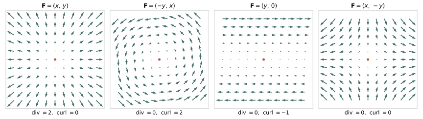

## 问题是什么

一个向量场在某一点附近"在做什么"？散度 (Divergence) 和旋度 (Curl) 各自回答了其中哪一部分，又漏掉了什么？

教材通常直接给出 $\nabla\cdot\mathbf{F}$ 和 $\nabla\times\mathbf{F}$ 的分量公式，再配上"源"和"涡旋"的图。这样容易记住公式，却看不出它们为什么长这个样子。本章从[第 1 章](/zh/notes/jacobian-and-gradient/)的雅可比出发，说明散度和旋度都是从雅可比中提取出来的信息。

## 直觉怎么理解

把向量场 $\mathbf{F}$ 想成流体的速度场，在某一点放一个很小的流体团，观察它在一小段时间内的变化。这个变化可以拆成四种：

- **平移**：整体随速度 $\mathbf{F}(\mathbf{x})$ 移动；
- **均匀膨胀或压缩**：体积变大或变小，形状不变；
- **旋转**：像刚体一样转动；
- **保体积形变**：一个方向拉长、另一个方向压扁，体积不变。

平移由场的值决定，后三种由雅可比决定。散度读出的是第二种，旋度读出的是第三种。第四种两者都读不到。

下图是四个典型的二维场。前两个分别是纯膨胀和纯旋转；第三个是简单剪切，它同时包含旋转和形变；第四个是纯形变，散度和旋度都为零，但它显然不是一个平凡的场。



## 数学 / 几何表达

记 $\mathbf{F} = (P, Q, R)^\top$，下标表示偏导，例如 $P_y = \partial P / \partial y$。雅可比为

$$
J =
\begin{bmatrix}
P_x & P_y & P_z \\
Q_x & Q_y & Q_z \\
R_x & R_y & R_z
\end{bmatrix}.
$$

### 散度是雅可比的迹

$$
\nabla\cdot\mathbf{F} = P_x + Q_y + R_z = \operatorname{tr} J .
$$

**为什么迹对应体积变化。** 速度场在时间 $dt$ 内把点 $\mathbf{x} + \mathbf{h}$ 移到 $\mathbf{x} + \mathbf{h} + \mathbf{F}(\mathbf{x} + \mathbf{h})\,dt$。相对于流体团中心，小位移 $\mathbf{h}$ 被映射为

$$
\mathbf{h} \mapsto (I + J\,dt)\,\mathbf{h} + o(\|\mathbf{h}\|) .
$$

小体积元的体积缩放比例是这个线性映射的行列式。按 Leibniz 公式，$\det(I + J\,dt)$ 是所有置换对应乘积之和：

- 恒等置换给出对角线乘积 $\prod_i (1 + J_{ii}\,dt) = 1 + \operatorname{tr}J\,dt + O(dt^2)$；
- 其余每个置换至少包含两个非对角元素，每个都带一个 $dt$，所以贡献为 $O(dt^2)$。

于是

$$
\det(I + J\,dt) = 1 + \operatorname{tr}J\,dt + O(dt^2),
\qquad
\frac{1}{V}\frac{dV}{dt} = \nabla\cdot\mathbf{F} .
$$

散度是局部体积的瞬时相对变化率：正值表示膨胀，负值表示压缩，零表示体积一阶不变。散度为零既不意味着速度为零，也不意味着形状不变。

注意区分两个容易混淆的量：$\det J$ 描述一个空间映射本身的局部体积缩放，$\operatorname{tr}J$ 描述速度场造成的体积变化率。两者通过上面的短时间映射 $I + J\,dt$ 联系起来。

### 旋度来自雅可比的反对称部分

$$
\nabla\times\mathbf{F} =
\begin{bmatrix}
R_y - Q_z \\ P_z - R_x \\ Q_x - P_y
\end{bmatrix}.
$$

每个分量都是雅可比中一对对称位置元素之差，所以它只依赖反对称部分 $W = \frac12(J - J^\top)$。

**旋度的一半是局部角速度。** 记 $\boldsymbol{\omega} = \nabla\times\mathbf{F}$，叉乘矩阵为

$$
[\boldsymbol{\omega}]_\times =
\begin{bmatrix}
0 & -\omega_3 & \omega_2 \\
\omega_3 & 0 & -\omega_1 \\
-\omega_2 & \omega_1 & 0
\end{bmatrix},
\qquad [\boldsymbol{\omega}]_\times \mathbf{h} = \boldsymbol{\omega} \times \mathbf{h} .
$$

逐项写出 $J - J^\top$：

$$
J - J^\top =
\begin{bmatrix}
0 & P_y - Q_x & P_z - R_x \\
Q_x - P_y & 0 & Q_z - R_y \\
R_x - P_z & R_y - Q_z & 0
\end{bmatrix}.
$$

与 $[\boldsymbol{\omega}]_\times$ 逐个比较：$(1,2)$ 位置 $-\omega_3 = P_y - Q_x$，$(1,3)$ 位置 $\omega_2 = P_z - R_x$，$(2,3)$ 位置 $-\omega_1 = Q_z - R_y$，完全吻合。因此

$$
J - J^\top = [\nabla\times\mathbf{F}]_\times ,
\qquad
W\mathbf{h} = \tfrac12\,(\nabla\times\mathbf{F}) \times \mathbf{h} .
$$

刚体以角速度 $\boldsymbol{\Omega}$ 转动时，速度为 $\boldsymbol{\Omega} \times \mathbf{h}$。比较可知，流体团的局部刚体旋转角速度为

$$
\boldsymbol{\Omega} = \tfrac12\,\nabla\times\mathbf{F} .
$$

三维反对称矩阵恰好有三个独立分量，所以能用一个轴向量表示，这也是旋度只在三维时才是向量的原因。二维情形下，反对称部分只有一个分量，旋度写成标量 $Q_x - P_y$，表示垂直于平面的转动。

**例子。** $\mathbf{F} = (-2y, 2x, 0)^\top$ 是绕 $z$ 轴、角速度为 2 的刚体旋转。它的散度为 0，旋度为 $(0, 0, 4)^\top$，正好是角速度的两倍。

### 雅可比的完整分解

把雅可比分成对称部分和反对称部分，再从对称部分中分出迹：

$$
J =
\underbrace{\frac{\operatorname{tr}J}{3}\,I}_{\text{均匀膨胀}}
+ \underbrace{\Big(\frac{J + J^\top}{2} - \frac{\operatorname{tr}J}{3}\,I\Big)}_{\text{对称无迹形变}}
+ \underbrace{\frac{J - J^\top}{2}}_{\text{旋转}} .
$$

三部分的自由度分别为 $1 + 5 + 3 = 9$，合起来正好是雅可比的九个元素。散度只读出第一部分（1 个数），旋度只读出第三部分（3 个数），中间 5 个自由度的保体积形变两者都读不到。

**反例。** $\mathbf{F} = (x, -y, 0)^\top$ 的雅可比为 $\operatorname{diag}(1, -1, 0)$，散度和旋度都为零，但它沿 $x$ 方向拉伸、沿 $y$ 方向压缩。所以仅凭一点的散度和旋度，无法恢复该点的雅可比。

**简单剪切。** 图中的 $\mathbf{F} = (y, 0)$ 的雅可比为 $\begin{bmatrix} 0 & 1 \\ 0 & 0 \end{bmatrix}$。它的对称部分 $\begin{bmatrix} 0 & 1/2 \\ 1/2 & 0 \end{bmatrix}$ 是形变，反对称部分 $\begin{bmatrix} 0 & 1/2 \\ -1/2 & 0 \end{bmatrix}$ 是角速度为 $-1/2$（顺时针）的旋转，二维旋度 $Q_x - P_y = -1$。看起来只是"一层层平移"的流动，其实同时包含旋转和形变。

### 积分形式：通量与环流

散度和旋度还有不依赖坐标的定义。

**散度是单位体积的净流出通量。** 取以 $\mathbf{x}$ 为中心、边长为 $h$ 的小立方体。垂直于 $x$ 轴的两个面上，净流出通量为

$$
\big[P(x + \tfrac{h}{2}) - P(x - \tfrac{h}{2})\big]\,h^2 \approx P_x\, h^3 ,
$$

另外两对面同理。三项相加，得到净流出通量 $\approx (P_x + Q_y + R_z)\,h^3$。所以

$$
\nabla\cdot\mathbf{F}(\mathbf{x}) = \lim_{V \to \mathbf{x}} \frac{1}{|V|}\oint_{\partial V} \mathbf{F}\cdot\mathbf{n}\, dS .
$$

**旋度分量是单位面积的环流量。** 对过 $\mathbf{x}$、法向为 $\mathbf{n}$ 的小曲面 $S$，

$$
(\nabla\times\mathbf{F})\cdot\mathbf{n} = \lim_{S \to \mathbf{x}} \frac{1}{|S|}\oint_{\partial S} \mathbf{F}\cdot d\mathbf{r} ,
$$

其中边界方向与 $\mathbf{n}$ 满足右手定则。

把这些局部关系在整个区域上累加，内部相邻小块的贡献互相抵消，只剩下边界，于是得到两个积分定理：

| 定理 | 公式 | 含义 |
|---|---|---|
| 散度定理 (Divergence Theorem) | $\int_V \nabla\cdot\mathbf{F}\, dV = \oint_{\partial V} \mathbf{F}\cdot\mathbf{n}\, dS$ | 内部净源的总和等于边界的净通量 |
| Stokes 定理 | $\int_S (\nabla\times\mathbf{F})\cdot\mathbf{n}\, dS = \oint_{\partial S} \mathbf{F}\cdot d\mathbf{r}$ | 面内局部环流的总和等于边界环流 |

两个定理都要求场足够光滑、区域足够规则，并且定向一致。第 3 章推导泊松方程时会用到散度定理。

### 两个零恒等式

**梯度场无旋**：$\nabla\times(\nabla f) = 0$。以第一分量为例，它等于 $\partial_y\partial_z f - \partial_z\partial_y f$。$f$ 二阶连续可微时混合偏导可交换，所以为零；另外两个分量同理。

**旋度场无散**：$\nabla\cdot(\nabla\times\mathbf{F}) = 0$。展开得

$$
\partial_x(R_y - Q_z) + \partial_y(P_z - R_x) + \partial_z(Q_x - P_y) = 0 ,
$$

六项两两抵消，原因同样是混合偏导可交换。

两个恒等式都要求场足够光滑，在奇点处不能直接套用。

**反过来，零旋度能否推出存在势函数？** 只有在单连通区域上才行。考虑定义在 $\mathbb{R}^2 \setminus \{0\}$ 上的场

$$
\mathbf{F} = \frac{(-y,\; x)}{x^2 + y^2} .
$$

直接计算可得 $Q_x = P_y = (y^2 - x^2)/(x^2 + y^2)^2$，所以处处 $Q_x - P_y = 0$。但沿单位圆一周，$\mathbf{F}\cdot d\mathbf{r} = d\theta$，环流量为 $2\pi \neq 0$。如果 $\mathbf{F} = \nabla\phi$，任意闭合回路上的环流都应为零，所以这个场没有全局势函数。原因是区域在原点处有一个洞。

### 使用约定

- $\nabla$ 是微分算符，不是数值向量。"点乘""叉乘"的写法便于记忆，但作用于乘积时仍需使用乘积法则，例如 $\nabla\cdot(\phi\mathbf{F}) = \nabla\phi\cdot\mathbf{F} + \phi\,\nabla\cdot\mathbf{F}$。
- 本章公式只适用于笛卡尔坐标。柱坐标和球坐标中，基向量随位置变化，散度和旋度的分量公式会多出尺度因子项，不能照搬。
- 有些中文材料把 $\nabla$ 称为"哈密顿算子"。为避免与量子力学中的哈密顿算符 $\hat{H}$ 混淆，本站称它为 nabla 或 del。

## 机器人中的例子

### 光流的散度与碰撞时间

无人机或机器人沿光轴方向接近一个正对着的平面时，图像上的光流 (Optical Flow) 从一点向外辐射。这一点称为扩展焦点 (Focus of Expansion, FOE)。光流的散度直接给出碰撞时间 (Time to Contact, TTC)。

设相机以速度 $W$ 沿光轴前进，平面在深度 $Z$ 处。在相机坐标系中，场景点的速度为 $(\dot{X}, \dot{Y}, \dot{Z}) = (0, 0, -W)$。归一化图像坐标为 $x = X/Z$，$y = Y/Z$，对时间求导：

$$
\dot{x} = \frac{\dot{X}}{Z} - \frac{X\dot{Z}}{Z^2} = \frac{W}{Z}\,x ,
\qquad
\dot{y} = \frac{W}{Z}\,y .
$$

光流场 $(\dot{x}, \dot{y}) = \frac{W}{Z}(x, y)$ 正是图中的"源"场，FOE 在主点。它的散度为

$$
\frac{\partial \dot{x}}{\partial x} + \frac{\partial \dot{y}}{\partial y} = \frac{2W}{Z} = \frac{2}{\tau},
\qquad \tau = \frac{Z}{W} .
$$

这个结论有三个值得注意的地方：

- 只要测出光流的散度，就能得到碰撞时间 $\tau$，不需要知道深度 $Z$ 和速度 $W$ 各自是多少；
- 换成像素坐标 $u = f x + c_x$ 时，光流和坐标同时乘以 $f$，所以散度不变，也不需要知道焦距；
- 散度反映的是"膨胀"，而第 1 章投影雅可比的第三列告诉我们，沿光轴的运动正是使图像点沿径向移动的那部分。

正因为这些性质，光流散度被广泛用于微型飞行器的避障和降落控制，例如保持散度恒定以实现平滑减速着陆。上面的推导只适用于纯前向运动和正对的平面；存在横向平移、平面倾斜或旋转时，散度中还会出现其他项，需要先做补偿。

光流的旋度则对应绕光轴的转动。若相机以角速度 $\omega_z$ 绕光轴旋转，场景点在相机坐标系中的速度为 $(\omega_z Y, -\omega_z X, 0)$，图像光流为 $(\omega_z y, -\omega_z x)$，其二维旋度为 $-2\omega_z$：大小是角速度的两倍，方向与相机转动相反。这与上一节"旋度的一半是角速度"一致。

## 可视化 / 代码

第一段代码在网格上数值计算四个典型场的散度和旋度，对应图中的四个面板，并给出画图的代码。

```python
import numpy as np
import matplotlib.pyplot as plt

x = np.linspace(-1, 1, 41)
y = np.linspace(-1, 1, 41)
X, Y = np.meshgrid(x, y)              # 形状 (ny, nx)，X 沿 axis=1 变化

fields = {
    "source": (X, Y),                 # 源
    "vortex": (-Y, X),                # 涡旋
    "shear":  (Y, 0 * X),             # 简单剪切
    "strain": (X, -Y),                # 纯形变
}

def div_curl(P, Q):
    dP_dy, dP_dx = np.gradient(P, y, x)
    dQ_dy, dQ_dx = np.gradient(Q, y, x)
    return dP_dx + dQ_dy, dQ_dx - dP_dy

for name, (P, Q) in fields.items():
    d, c = div_curl(P, Q)
    print(f"{name:7s} div = {round(d.mean(), 2) + 0.0:+.2f}   curl = {round(c.mean(), 2) + 0.0:+.2f}")
# source  div = +2.00   curl = +0.00
# vortex  div = +0.00   curl = +2.00
# shear   div = +0.00   curl = -1.00
# strain  div = +0.00   curl = +0.00

fig, axes = plt.subplots(1, 4, figsize=(12, 3.4))
s = slice(None, None, 4)
for ax, (name, (P, Q)) in zip(axes, fields.items()):
    ax.quiver(X[s, s], Y[s, s], P[s, s], Q[s, s])
    ax.set_title(name)
    ax.set_aspect("equal")
plt.show()
```

第二段代码合成接近平面时的光流，验证散度等于 $2/\tau$，并验证绕光轴旋转时旋度为 $-2\omega_z$。

```python
import numpy as np

W, Z = 2.0, 10.0                      # 接近速度 2 m/s，深度 10 m，tau = 5 s
f = 400.0                             # 焦距（像素）
px = np.linspace(-200, 200, 81)       # 以主点为原点的像素坐标
U, V = np.meshgrid(px, px)
xn, yn = U / f, V / f                 # 归一化坐标

# 纯前向运动：像素光流 = f * (W/Z) * (x, y)
flow_u, flow_v = f * xn * W / Z, f * yn * W / Z
div = np.gradient(flow_u, px, axis=1) + np.gradient(flow_v, px, axis=0)
print(div.mean(), 2 * W / Z, "tau =", 2 / div.mean())   # 约 0.4 0.4 tau = 5.0（浮点舍入）

# 绕光轴旋转：像素光流 = f * omega * (y, -x)
omega = 0.3
rot_u, rot_v = f * omega * yn, -f * omega * xn
curl = np.gradient(rot_v, px, axis=1) - np.gradient(rot_u, px, axis=0)
print(curl.mean(), -2 * omega)                          # 约 -0.6 -0.6
```

## 参考资料

1. Koenderink, J. J., & van Doorn, A. J. (1976). Local structure of movement parallax of the plane. *Journal of the Optical Society of America*, 66(7), 717–723.
2. Lee, D. N. (1976). A theory of visual control of braking based on information about time-to-collision. *Perception*, 5(4), 437–459.
3. Herissé, B., Hamel, T., Mahony, R., & Russotto, F.-X. (2012). Landing a VTOL unmanned aerial vehicle on a moving platform using optical flow. *IEEE Transactions on Robotics*, 28(1), 77–89.
4. Schey, H. M. (2005). *Div, Grad, Curl, and All That* (4th ed.). W. W. Norton.
5. OpenStax. *Calculus Volume 3*, Section 6.5: Divergence and Curl. https://openstax.org/books/calculus-volume-3/pages/6-5-divergence-and-curl
6. 3Blue1Brown. Divergence and curl: The language of Maxwell's equations, fluid flow, and more. https://www.3blue1brown.com/lessons/divergence-and-curl/
7. MIT OpenCourseWare. 18.02SC Multivariable Calculus (Fall 2010)，第四单元：三维空间中的三重积分与曲面积分（含散度定理与 Stokes 定理）。https://ocw.mit.edu/courses/18-02sc-multivariable-calculus-fall-2010/
