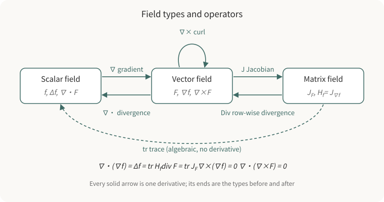

## What this series covers

Gradient, divergence, curl, the Jacobian, the Hessian and the Laplacian usually arrive as a list of formulas. Textbooks introduce them one definition at a time, and readers tend to remember them as unrelated names.

This series organizes them around one line of reasoning:

1. **The derivative is a local linear map.** Zoom in on a map near a point and it looks like a matrix; that matrix is the Jacobian. The Jacobian of a scalar field is a single row, and its transpose is the gradient.
2. **Divergence and curl extract specific information from the Jacobian.** Divergence is its trace and reads off the local change of volume. Curl encodes its antisymmetric part and reads off the local rotation. Even together they do not recover the full derivative, because volume-preserving deformation is left out.
3. **Differentiating again gives second-order structure.** The Jacobian of the gradient is the Hessian, and the trace of the Hessian is the Laplacian. Accumulating local derivatives gives the "interior versus boundary" relations of the divergence theorem and Stokes' theorem.

The figure draws these operations as arrows between types. An arrow tells you what can follow what, but two type-correct paths need not be equal; each identity has to be proved, which Chapters 2 and 3 do.

Each chapter ends in concrete robotics and 3D-vision uses: the Jacobian of camera projection and pose optimization, optical-flow divergence and time to contact, and Poisson surface reconstruction.

Unless stated otherwise, the series works in Cartesian coordinates of 3D Euclidean space, with column vectors, functions that have as many continuous partial derivatives as needed, and the right-hand rule for the direction of curl.

## How the chapters connect

1. [The Jacobian and the gradient](/notes/jacobian-and-gradient/): generalize the one-variable Taylor expansion and the derivative becomes the Jacobian matrix. The transpose of a scalar field's Jacobian is the gradient, which points in the direction of steepest ascent and is normal to level sets.
2. [Divergence and curl](/notes/divergence-and-curl/): split the Jacobian into uniform expansion, volume-preserving deformation and rotation. Divergence is the trace; curl comes from the antisymmetric part; their integral forms lead to the divergence theorem and Stokes' theorem.
3. [Hessian, Laplacian and Poisson reconstruction](/notes/hessian-laplacian-poisson/): take the Jacobian of the gradient to get the Hessian, and its trace to get the Laplacian. Collect the second-order identities and derive the Poisson surface reconstruction equation $\Delta\chi = \nabla\cdot\mathbf{V}$.

The chapters build on each other in order. Chapter 2 uses the Jacobian notation of Chapter 1 to derive the curl, and Chapter 3 uses the divergence theorem from Chapter 2 in the Poisson derivation.

## Before you start

- **Single-variable calculus**: derivatives, Taylor expansion, the chain rule.
- **Linear algebra**: matrix multiplication, transpose, trace and determinant, symmetric and antisymmetric matrices, the cross product. [Inner products, covariance and correlation](/notes/inner-product-covariance-correlation/) is useful first; Chapter 1 uses its Cauchy–Schwarz inequality.
- **Partial derivatives**: being able to compute them is enough; no prior vector analysis is assumed.
- **Code**: examples use Python, NumPy, SciPy, SymPy and matplotlib.
