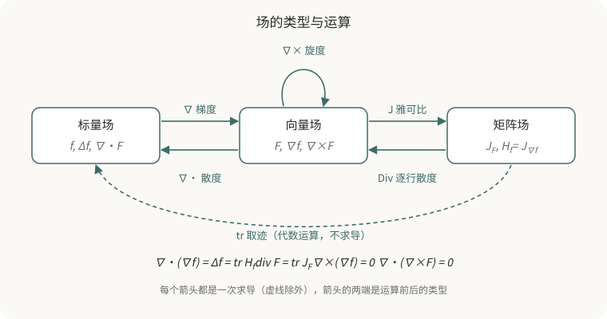

## 这个系列讲什么

梯度 (Gradient)、散度 (Divergence)、旋度 (Curl)、雅可比矩阵 (Jacobian)、海森矩阵 (Hessian)、拉普拉斯算子 (Laplacian) 通常以一串公式的形式出现。教材按定义逐个介绍，读者很容易把它们记成彼此独立的名词。

本系列用一条主线把它们组织起来：

1. **导数是局部线性映射。** 把一个映射放大到某一点附近，它看起来就像一个矩阵，这个矩阵就是雅可比。标量场的雅可比只有一行，转置后就是梯度。
2. **散度和旋度是从雅可比中提取的特定信息。** 散度是雅可比的迹，读出局部体积变化；旋度编码雅可比的反对称部分，读出局部旋转。两者合起来也不等于完整的导数，因为不改变体积的形变被漏掉了。
3. **再求一次导数，得到二阶结构。** 梯度的雅可比是海森，海森的迹是拉普拉斯。把局部的微分累积起来，就得到散度定理和 Stokes 定理这类"局部与边界"的关系。

下图把这些运算画成类型之间的箭头。箭头说明了"什么可以接在什么后面"，但类型合法不代表两条路径相等，具体的恒等式需要逐个证明，第 2、3 章会完成这件事。

每一章都落到机器人与三维视觉中的具体用法：相机投影的雅可比和位姿优化，光流散度与碰撞时间，以及泊松表面重建。

除特别说明外，全系列使用三维欧氏空间的笛卡尔坐标，向量为列向量，函数具有所需阶数的连续偏导，旋度方向按右手定则确定。

## 章节之间的关系

1. [雅可比与梯度](/zh/notes/jacobian-and-gradient/)：从一元泰勒展开推广到多元，导数变成雅可比矩阵；标量场的雅可比转置后是梯度，它给出最快上升方向，并垂直于等值面。
2. [散度与旋度](/zh/notes/divergence-and-curl/)：把雅可比分解为均匀膨胀、保体积形变和旋转三部分。散度是迹，旋度来自反对称部分；它们的积分形式引出散度定理和 Stokes 定理。
3. [海森、拉普拉斯与泊松重建](/zh/notes/hessian-laplacian-poisson/)：对梯度再求一次雅可比得到海森，取迹得到拉普拉斯；整理二阶恒等式，并推导泊松表面重建方程 $\Delta\chi = \nabla\cdot\mathbf{V}$。

三章依次依赖。第 2 章的旋度推导会用到第 1 章的雅可比记号，第 3 章的泊松推导会用到第 2 章的散度定理。

## 预备知识

- **一元微积分**：导数、泰勒展开、链式法则。
- **线性代数**：矩阵乘法、转置、迹与行列式、对称与反对称矩阵、叉乘。可以先读[内积、协方差与相关系数](/zh/notes/inner-product-covariance-correlation/)，第 1 章会用到其中的 Cauchy–Schwarz 不等式。
- **多元偏导**：会计算偏导数即可，不需要事先学过向量分析。
- **代码**：示例使用 Python、NumPy、SciPy、SymPy 和 matplotlib。
